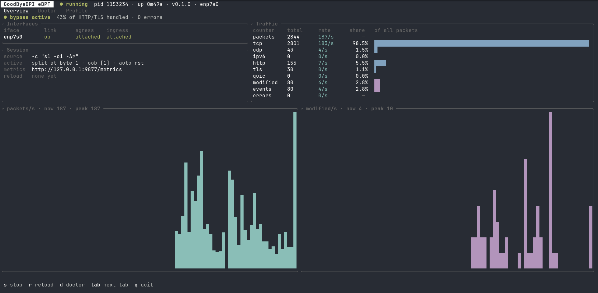

# CLI/TUI `goodbyedpi`

`goodbyedpi` — фронтенд к `goodbyedpi-daemon`: управление сервисом, проверка
профилей, hot reload и диагностика. Парсер профилей и проверка eBPF-объекта —
тот же код, что в демоне (крейт `goodbyedpi-daemon` подключён как библиотека),
поэтому `validate` и `doctor` не расходятся с тем, что увидит демон.

## Команды

| Команда | Что делает | Нужен root |
| --- | --- | --- |
| `goodbyedpi start -i eth0 -c "s1 -o1 -Ar"` | валидирует профиль, запускает демон в фоне, ждёт готовности | да |
| `goodbyedpi start ... --foreground` | `exec` демона в текущем терминале | да |
| `goodbyedpi start ... --dry-run` | план (clsact/фильтры), профиль, проверка объекта; ничего не меняет | для verifier |
| `goodbyedpi stop` | SIGTERM и ожидание снятия TC-хуков | да |
| `goodbyedpi reload` | локальная валидация профиля демона → SIGHUP → результат из `state.json` | да |
| `goodbyedpi status [--json]` | pid, uptime, профиль, хуки по интерфейсам, счётчики | нет |
| `goodbyedpi validate -f profile.txt [--strict] [--dry-run]` | ошибки с `файл:строка:колонка`, lint-предупреждения | нет |
| `goodbyedpi doctor [-i eth0] [--json]` | объясняет, почему демон не стартует / не работает | желательно |
| `goodbyedpi tui` | интерактивная панель | для действий |

Без `-i` берётся интерфейс default route, иначе первый поднятый физический.
Несколько интерфейсов: `-i eth0,wlan0` или `-i eth0 -i wlan0`.
Аргументы демона, которых нет в CLI, передаются после `--`:
`goodbyedpi start -i eth0 -c s1 -- --no-metrics --bpf-printk`.

Старые флаги (`--daemon`, `--status`, `--stop`, `-i`, `-c` без подкоманды) продолжают работать.

## Профили: validate и dry-run

```text
$ goodbyedpi validate -f bad.txt
✗ profile invalid: Unknown auto flag 'x' in token '-Ax'. ...
  --> bad.txt:5:1
   | -Ax
   | ^
```

Помимо синтаксиса, lint ловит профили, которые корректны, но не делают того,
чего ждёт пользователь: ни одной техники обхода, `s0`, несколько OOB-позиций
(используется первая), размер фрагмента не кратен 8 или ≥ 1200 (QUIC Initial
уйдёт целиком), UDP-фильтр без 443 при `-g`, TCP-фильтр без 80/443.
`--strict` превращает предупреждения в ошибку — удобно для CI.

`--dry-run` дополнительно открывает встроенный eBPF-объект, сверяет размеры
значений карт с `repr(C)` структурами из `proto` и, под root, загружает
программы в verifier **без attach** — после проверки они сразу выгружаются.
У демона есть такой же флаг: `goodbyedpi-daemon --dry-run -i eth0 -c ...`.

## doctor

Группы проверок:

- **kernel** — версия ≥ 5.8 (ring buffer, CAP_BPF), `/sys/kernel/btf/vmlinux`,
  `CONFIG_BPF_SYSCALL`/`NET_CLS_BPF`/`NET_SCH_INGRESS`/`NET_CLS_ACT`/`DEBUG_INFO_BTF`
  и JIT из `/proc/config.gz` или `/boot/config-*`, режим lockdown, RLIMIT_MEMLOCK на ядрах < 5.11;
- **privileges** — CapEff (CAP_BPF или CAP_SYS_ADMIN, CAP_NET_ADMIN, CAP_NET_RAW), реальное открытие `SOCK_RAW`;
- **tools** — `tc`, `bpftool`, bpffs, другие DPI-обходчики (nfqws, tpws, byedpi…), которые трогают тот же трафик;
- **daemon** — жив ли процесс, устаревший pid-файл после падения, отклонённый последний reload, занят ли порт метрик;
- **interfaces** — существование (с подсказкой доступных и default route), тип линка
  (на tun/wireguard/ppp нет Ethernet-заголовка, а программа парсит `ETH_HLEN=14`), operstate;
- **TC-конфликты** — классический `ingress` qdisc (не даёт создать clsact), чужой bpf-фильтр
  в слоте pref 1/handle 1 (attach упадёт с EEXIST), прочие чужие фильтры, tcx- и XDP-программы,
  наши фильтры без демона (осиротевшие после краша — с готовыми командами удаления),
  демон жив, а хуков нет (интерфейс пересоздан VPN/Wi-Fi);
- **ebpf** — объект встроен (не пустой — значит собран с clang), программы и карты на месте,
  ABI карт совпадает с Rust, пробная загрузка в verifier с разбором лога:
  EPERM, нет BTF, CO-RE relocation, неизвестный helper, лимит сложности, неограниченный цикл,
  выход за границы пакета; последние строки verifier-лога прикладываются;
- **live maps** — при живом демоне в ядре есть `dpi_egress`/`dpi_ingress` и карты
  `config_map`, `conn_map`, `events`, `sni_cache`, `stats_map`;
- **profile** — профиль демона (или переданный `-c`/`-f`) разбирается и проходит lint.

Код возврата `1`, если есть хоть один `FAIL`. `--json` — для issue-шаблонов и скриптов.
Без root часть проверок помечается `SKIP` с объяснением.

## Hot reload

`SIGHUP` (`goodbyedpi reload` или `systemctl reload goodbyedpi`) перечитывает
файл профиля и `-c`. Применение атомарное и безопасное:

1. CLI сначала валидирует профиль сам, из cwd демона (относительные пути списков);
   при ошибке сигнал не отправляется.
2. Демон разбирает и сериализует новый конфиг; при любой ошибке старый остаётся
   в силе и в userspace, и в `config_map`.
3. Смена `-Ar/-At/-As` отклоняется: auto-logic создаётся один раз при старте — нужен рестарт.
4. Новый конфиг рассылается во все BPF-потоки (по одному на интерфейс), hostlist/ipset перечитываются.
5. Итог (`generation`, `ok`, `message`) пишется в `state.json`; CLI и TUI его показывают.

Состояние, накопленное auto-logic (подобранные split/tlsrec), при reload сбрасывается к профилю.

## TUI



`goodbyedpi tui` (опционально `-i`/`-c`/`-f`, чтобы можно было стартовать демон из панели).

- **Overview** — интерфейсы и состояние хуков egress/ingress, итог последнего reload,
  счётчики с rate/s, спарклайны packets/s и modified/s;
- **Doctor** — список проверок и детали выбранной с подсказкой «fix»;
- **Profile** — активный профиль, сводка техник и lint.

Клавиши: `s` start/stop (stop — двойное нажатие), `r` reload, `d` doctor,
`Tab`/`←→`/`1-3` вкладки, `↑↓`/`j k` выбор, `q` выход.

## Runtime-файлы

`/run/goodbyedpi/` (меняется `--run-dir` у CLI и демона):

- `daemon.pid` — защищает от второго экземпляра; устаревший файл игнорируется;
- `state.json` — интерфейсы, профиль, адрес метрик, статус reload;
- `daemon.log` — stdout/stderr демона, запущенного через `goodbyedpi start`.

## Пакеты и systemd

```bash
./scripts/build-packages.sh deb    # Debian/Ubuntu
./scripts/build-packages.sh rpm    # Fedora
./scripts/build-packages.sh arch   # Arch Linux
sudo make install                  # без пакета, в /usr/local
```

Файлы в `packaging/`. Все пакеты ставят одно и то же через `make install`:
`goodbyedpi`, `goodbyedpi-daemon`, `goodbyedpi.service`,
`/etc/goodbyedpi/{goodbyedpi.conf,profile.txt}` (conffiles),
списки/бинарные fake-профили/примеры в `/usr/share/goodbyedpi`.

eBPF-объект встраивается в бинарник демона (`include_bytes!`), поэтому установленный
демон не зависит от каталога сборки.

```bash
sudoedit /etc/goodbyedpi/goodbyedpi.conf   # GDPI_INTERFACES=enp7s0
sudo systemctl enable --now goodbyedpi
sudo systemctl reload goodbyedpi           # после правки profile.txt
```

Unit запускает `goodbyedpi validate` в `ExecStartPre`, так что битый профиль
виден в `journalctl -u goodbyedpi` со строкой и колонкой ещё до attach к TC.
Debian-пакет не включает и не стартует сервис сам: интерфейс по умолчанию почти всегда не тот.

Требуется Rust ≥ 1.87 (rustup на Debian/Ubuntu; в Arch и Fedora — из репозиториев).
